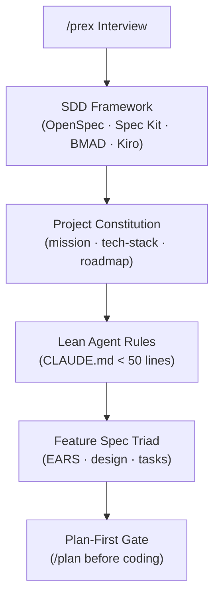

<div align="center">

# preX (`/prex`)

**Stop vibe-coding drift before it starts. Turn a plain-language interview into Spec-Driven Development contracts before writing a single line of code.**

[](LICENSE) [](SKILL.md) [](SKILL.md) [](references/ears-framework.md)


Works with Claude Code, Claude.ai, and Agent Skills-compatible coding agents.

</div>

---

## Why preX?

AI coding agents drift when dropped straight into code without boundaries. **preX** interviews you in plain, jargon-free language—explaining each question with concrete examples—and produces a lean, immutable **Project Constitution**, **EARS-formatted requirements**, and **atomic tasks** gated behind Plan Mode.



## Quickstart

Clone into your personal Claude Code skills directory and invoke `/prex`:

```bash
git clone https://github.com/shifulegend/prex.git ~/.claude/skills/prex
```

> [!TIP]
> To scope the skill to a single repository instead of installing globally, clone it into your project's `.claude/skills/prex/` directory.

## What `/prex` Generates

| Artifact | Purpose | Key Guardrail |
| :--- | :--- | :--- |
| `specs/mission.md` | Product purpose, 3-5 personas, v1 scope, NFRs | Explicit in-scope / out-of-scope boundaries |
| `specs/tech-stack.md` | Pinned versions, DB schema, API contracts, CI/CD | Build-time estimate & security baseline |
| `specs/roadmap.md` | Chronological implementation phases | Keeps early code aligned with later phases |
| `CLAUDE.md` | Commands, coverage target, directory map, boundaries | Strictly < 50 lines to prevent instruction dilution |
| `requirements.md` | Unambiguous functional behavior | Written in EARS syntax mapped to tests |
| `design.md` | Data models, migrations, pagination, caching, JSDoc | Includes up/down SQL & rollback plan |
| `tasks.md` | Atomic sequential steps with lint/test gates | Locks Plan Mode (`/plan`) before execution |

<details>
<summary><strong>Repository Structure &amp; Progressive Disclosure</strong></summary>

```text
prex/
├── SKILL.md
├── LICENSE
├── README.md
├── evals/
│   └── evals.json
└── references/
    ├── ears-framework.md
    ├── sdd-frameworks.md
    └── canonical-templates.md
```

</details>

> [!NOTE]
> `preX` never generates application code during `/prex` and hands off to read-only Plan Mode (`/plan`) before any implementation begins.

## License

Distributed under the [MIT License](LICENSE).
